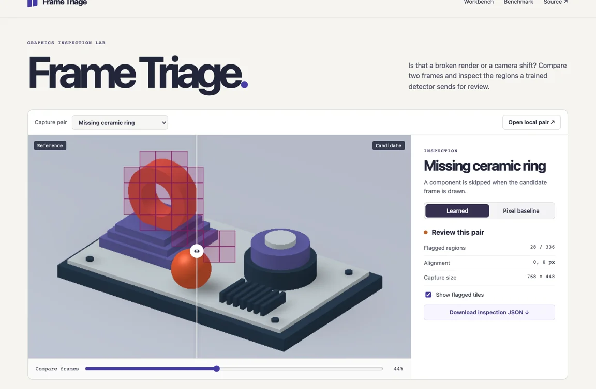

# Frame Triage

A graphics engineer reviewing screenshots has two questions. Did a part break, and where should someone look? Open a pair, drag the divider, then switch between a trained tile classifier and an aligned pixel baseline. The workbench runs locally with bundled model weights.



[Try the workbench in your browser](https://naxe-portfolio-review.vercel.app/labs/frame-triage/)

## Run the workbench

From this directory run the following, then open [the workbench](http://localhost:8040).

```sh
python3 -m http.server 8040 --bind 127.0.0.1 --directory web
```

Start with **Missing ceramic ring**, try **A real false alarm**, then open **Minnen camera projection**. Drag the image or use the keyboard-accessible slider. The overlay shows tiles in reference-frame coordinates. Open a local image pair to inspect your own frames and download the decisions, scores and alignment. Uploaded images stay in the tab. Both images must have equal dimensions, up to 12 million pixels. Transparent pixels composite over white.

## Reproduce a decision

The CLI and the browser execute the same JavaScript feature extractor and inference function. Use a current Node.js LTS release and PNG inputs.

```sh
npm ci
npm test
node tools/inspect.mjs web/assets/false-alarm-reference.png web/assets/false-alarm-candidate.png
```

The example is held-out scene 275 with a camera shift. The learned model sends it to review and the tuned pixel baseline clears it. Both outcomes are visible in the JSON. No API keys, network model calls or GPU are required for inference.

## What the experiment measured

The CPU renderer varies a mechanical assembly across scene seeds. For each seed it produces unchanged, exposure, camera-jitter, missing-part, changed-material and displaced-part pairs. The first three are benign in this experiment. Comparing the intervention with the aligned original defines an affected-pixel mask for each defect. Tiles with at least four pixels over a nine-level RGB-channel difference receive a positive label. Train, validation and test use disjoint seeds from one procedural scene family.

| Split | Scene seeds | Pairs |
| --- | ---: | ---: |
| Train | 60 | 360 |
| Threshold selection | 18 | 108 |
| Test | 26 | 156 |

Both methods share registration and operate on a 24 × 14 grid. A balanced logistic regression uses eight features per tile. The baseline uses mean local RGB residual. Each method separately selects a threshold on validation using frame F1, with mean defect-mask overlap breaking ties. A single flagged tile sends the frame to review. Model outputs are decision scores. The sensitive operating point near the top of the model's output range is specific to this benchmark.

| Test method | Defects caught / 78 | False alarms / 78 benign | Frame F1 | Mean defect-mask IoU |
| --- | ---: | ---: | ---: | ---: |
| Learned | 78 | 2 | .9873 | .8168 |
| Aligned pixel baseline | 74 | 0 | .9737 | .4993 |

The classifier raised two jitter alarms. The baseline missed four material changes. The case selector includes an exact image pair from each failure group. [Every held-out frame decision](web/assets/test-cases.json) and the [aggregate breakdown](web/assets/evaluation.json) are checked in. Results apply to this synthetic corpus. A renderer with different assets, lighting, camera motion or defect costs needs separate validation. The 192 × 112 sampling grid can lose very small changes.

## Rebuild the benchmark and fixtures

Use Python 3.13, the pinned dependencies and Node.js. Run from this directory. The generated dataset goes into the ignored data directory.

```sh
python3.13 -m venv .venv
.venv/bin/pip install -r requirements.txt
npm ci
.venv/bin/python tools/render.py data
node tools/extract.mjs data
.venv/bin/python tools/train.py data
node tools/verify-benchmark.mjs data
.venv/bin/python tools/showcase.py
.venv/bin/python tools/camera_capture.py ../../source
.venv/bin/python tools/catalog.py data
npm test
```

The pull-request check regenerates only the 26 held-out seeds on Linux and verifies the checked-in model and baseline against all 156 decisions and their mask overlaps. Use `python tools/render.py data --split test` to run that shorter path locally.

The Minnen fixture additionally needs Haxe on PATH. It executes the game's existing [LogCamera](../../source/logworld/LogCamera.hx) at two curvature settings against fixed world points. A two-field viewport stub provides the screen dimensions. A separate original illustration draws the projected grove. This is a camera fixture, independent of the mechanical training scene. The full game and GPU effects are outside this capture.

## Source and history

The game repository dates to 2018. The camera work predates this November 2026 tool. Frame Triage adds its own analytic renderer, labeled experiment, trained model, diagnostic UI and CLI. Original geometry and fixture artwork are generated by the checked-in code. This addition was developed with Codex assistance.
